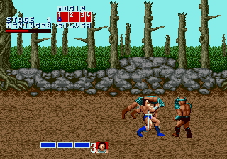
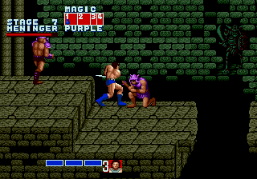
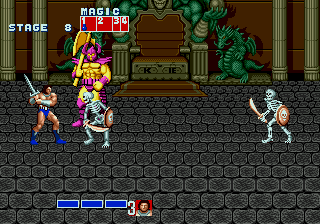
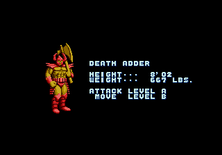

# Golden Axe - Enemy HUD & Golden Bosses

Hack de **Golden Axe** (Mega Drive / Genesis) que adiciona um HUD de inimigos no estilo *Final Fight* / *Streets of Rage 2* e devolve aos chefes finais o machado dourado que dá nome ao jogo.

*A ROM hack for **Golden Axe** (Mega Drive / Genesis) that adds a Final Fight / Streets of Rage 2 style enemy HUD and gives the final bosses the golden axe the game is named after. [English below](#english).*

| HUD na fase 1 | HUD na fase 7 |
|---|---|
|  |  |
| **Death Bringer dourado** | **Death Adder dourado** |
|  |  |

## Download

Baixe o patch na página de [Releases](../../releases) ou direto em [`patch/`](patch/).

## O que o hack faz

**HUD de inimigos**
- Abaixo de "STAGE", aparecem o nome e a barra de vida do último inimigo atingido. O HUD some 3 segundos depois do último golpe.
- Os nomes são os oficiais dos créditos finais do jogo, como HENINGER SILVER, PURPLE LONGMOAN, STORCHINAYA, BAD BROTHERS, LT.BITTER e DEATH ADDER.
- Os três Bitter e os três Death Adder são identificados pela cor da armadura, como nos créditos.
- O HUD é desenhado no plano fixo, sem usar sprites, então não causa flicker extra.

**Chefes dourados**
- **Death Adder:** pele e machado em dourado escuro.
- **Death Bringer:** pele e machado em dourado vivo.
- **Death Adder Jr.:** mantém as cores originais.

**Limitações**
- Com 2 jogadores, o HUD mostra só a barra, sem o nome.
- Montarias (Chicken-Leg, dragões) e ladrões não aparecem no HUD.
- "SGT.MALT AND SGT.HOP" aparece abreviado como "SGT.MALT AND HOP".

## Como aplicar

Aplique o `.ips` com o [Rom Patcher JS](https://www.marcrobledo.com/RomPatcher.js/), Floating IPS (Flips) ou Lunar IPS nesta ROM:

| | |
|---|---|
| ROM base | **Golden Axe (World) (Rev A)** |
| Cabeçalho | `GM 00054018-01` |
| CRC32 | `665D7DF9` |
| SHA-1 | `2CE17105CA916FBBE3AC9AE3A2086E66B07996DD` |
| **ROM resultante** CRC32 | `60E2C7BD` |
| **ROM resultante** SHA-1 | `1EA12E6A166C1DA80976ECCD3539D8AEE98544E1` |

> O patch **não** funciona na revisão original (Rev 0, cabeçalho `GM 00054018-00`, CRC32 `E8182B90`). Este repositório não contém ROMs: use a sua própria cópia do jogo.

## Código-fonte

O hack foi feito sobre o [disassembly do Golden Axe](https://www.romhacking.net/documents/719/) de Lorenzo (lory1990) e montado com o [Macroassembler AS](https://github.com/flamewing/asl-releases).

| Arquivo | Conteúdo |
|---|---|
| [`source/healthbars.asm`](source/healthbars.asm) | Código do HUD e da escolha dos nomes, incluído no fim da ROM |
| [`source/hb_font.inc`](source/hb_font.inc), [`hb_tiles.inc`](source/hb_tiles.inc), [`hb_tile_empty.inc`](source/hb_tile_empty.inc) | Fonte e tiles da barra |
| [`source/ga_asm_changes.diff`](source/ga_asm_changes.diff) | As poucas linhas alteradas no `ga.asm` original |

Para montar com uma versão atual do AS, troque também as três linhas `lea $00FF8000, a4` por `lea ($00FF8000).l, a4`. Sem isso, o AS atual encurta a instrução, desloca o código e a ROM sai quebrada. Montar com `-D START_STAGE=n` gera uma ROM que começa na fase `n`.

**Como o hack funciona, em resumo**
- Inimigos ficam nos slots `$FFD100`–`$FFD4FF` (`$80` bytes cada), com o tipo no byte 0 (`$2E`–`$4C`) e a vida no byte `$64`. A vida máxima é guardada no byte `$7E`, que o jogo não usa.
- Um gancho no fim da montagem dos sprites (`loc_B7F8`) detecta qual inimigo perdeu vida e atualiza o HUD no plano A, que não rola.
- Os tiles da barra ficam em espaços livres da VRAM (`$B380`, `$AB80`), e o nome é montado na área de tiles do jogador 2 (`$BE00`).
- Os chefes dourados são só uma troca de 4 cores nas paletas `loc_38BDC` (Death Adder) e `loc_38C20` (Death Bringer).

## Créditos

- **Hack:** Douglas Neto ([douugr](https://github.com/douugr))
- **Disassembly do Golden Axe:** Lorenzo (lory1990), feito com o Active Disassembler do emulador Exodus (Nemesis)
- **Assembler:** The Macroassembler AS

---

## English

**Enemy HUD**
- Below "STAGE", the name and health bar of the last enemy you hit appear. The HUD disappears 3 seconds after your last hit.
- Names are the official ones from the game's ending credits.
- The three Bitters and the three Death Adders are told apart by their armor color, as in the credits.
- Drawn on the fixed HUD plane, so it uses no sprites and causes no extra flicker.

**Golden bosses**
- **Death Adder:** skin and axe in dark gold.
- **Death Bringer:** skin and axe in bright gold.
- **Death Adder Jr.:** keeps his original colors.

**Limitations:** in 2-player games the HUD shows only the bar, without the name; mounts and thieves are not shown; "SGT.MALT AND SGT.HOP" is shortened to "SGT.MALT AND HOP".

**How to apply:** patch **Golden Axe (World) (Rev A)** (CRC32 `665D7DF9`, SHA-1 `2CE17105CA916FBBE3AC9AE3A2086E66B07996DD`) with [Rom Patcher JS](https://www.marcrobledo.com/RomPatcher.js/), Flips or Lunar IPS. The result should have CRC32 `60E2C7BD`. The patch does **not** work on Rev 0 (CRC32 `E8182B90`). No ROMs are included in this repository.

**Source:** see [`source/`](source/). Built on Lorenzo (lory1990)'s Golden Axe disassembly with the Macroassembler AS. When building with a current AS, also change the three `lea $00FF8000, a4` lines to `lea ($00FF8000).l, a4`.
